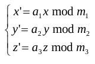

# 電子蝿

- CodeNet ID: `p00114`
- Dataset: `AIZU`
- Time limit: `1000 ms`
- Memory limit: `131072 KB`

ある計算機学者が電子空間に棲息する電子蝿という奇妙な生命体を見つけました。電子蝿の行動を観察しているうちに、この空間の (x, y, z) 地点にいる電子蝿は、次に以下の規則で示される (x', y', z')に移動することが分かりました。



ただし、a1, m1, a2, m2, a3, m3 は電子蝿の個体ごとに定まる正の整数です。A mod B は正の整数 A を正の整数 B で割ったときの余りです。

さらに観察をすると、ある種の電子蝿は (1,1,1) に置いてからしばらくすると、必ず (1,1,1) に戻ってくることがわかりました。このような蝿を戻り蝿と名付けました(1) 。

戻り蝿のデータを入力とし、(1,1,1) に戻ってくる最小の移動回数 (>0) を出力するプログラムを作成してください。なお 1< a1, m1, a2, m2, a3, m3 < 215 とします。

(1) a1 と m1, a2 と m2, a3 と m3 がそれぞれ互いに素 (公約数が 1) である時に戻ります。

## Input

複数のデータセットが与えられます。各データセットは以下の形式で与えられます。

```text
a1 m1 a2 m2 a3 m3
```

入力は６つの 0 を含む行で終わります。データセットの数は 50 を超えません。

## Output

各データセットごとに、(1,1,1) に戻ってくる最小の移動回数(整数)を１行に出力してください。

## Sample Input 1

```text
2 5 3 7 6 13
517 1024 746 6561 4303 3125
0 0 0 0 0 0
```

## Output for the Sample Input 1

```text
12
116640000
```
