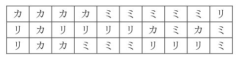
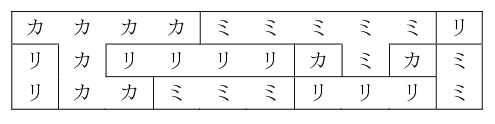

# Property Distribution

- CodeNet ID: `p00118`
- Dataset: `AIZU`
- Time limit: `1000 ms`
- Memory limit: `131072 KB`

Mr. Tanaka passed away, leaving behind an orchard of size H x W. The orchard is divided into H x W plots in the North-South and East-West directions, and in each plot, either apples, persimmons, or oranges are planted. Mr. Tanaka left the following will:

The orchard should be divided among as many relatives as possible on a per-plot basis. However, if plots adjacent to each other in any of the North, South, East, or West directions have the same type of fruit planted, the boundary between the plots cannot be distinguished, so they must be treated as one large plot.

For example, if there is a 3 x 10 plot as follows ('リ' represents apples, 'カ' represents persimmons, 'ミ' represents oranges):



Removing the boundaries between plots with the same trees results in the following:



Ultimately, it will be divided into 10 plots, meaning it can be shared among 10 people.

The distribution must be completed before it snows and the boundaries of the plots become invisible. Your job is to determine the number of plots to be distributed based on the map of the orchard.

Write a program that reads the map of the orchard and outputs the number of relatives who can receive a distribution.

## Input

Multiple datasets are given. Each dataset begins with a line containing H and W (H, W ≤ 100) separated by a space, followed by H lines of strings consisting of H x W characters. These strings contain only three characters: '@' representing apples, '#' representing persimmons, and '*' representing oranges.

The input ends with a line containing two zeros.
The number of datasets does not exceed 20.

## Output

For each dataset, output the number of people receiving the distribution on a single line.

## Sample Input 1

```text
10 10
####*****@
@#@@@@#*#*
@##***@@@*
#****#*@**
##@*#@@*##
*@@@@*@@@#
***#@*@##*
*@@@*@@##@
*@*#*@##**
@****#@@#@
0 0
```

## Output for the Sample Input 1

```text
33
```
