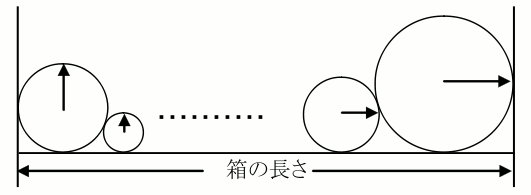
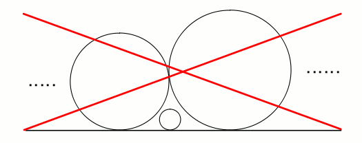

# Patissier

- CodeNet ID: `p00120`
- Dataset: `AIZU`
- Time limit: `1000 ms`
- Memory limit: `131072 KB`

A cake shop has made many roll cakes of various sizes. You have been assigned the task of arranging these cakes in a box.

Roll cakes are very soft, so they will be crushed if other roll cakes are placed on top of them. Therefore, as shown in Figure (a), all roll cakes must be arranged such that they are in contact with the bottom of the box. The required width changes depending on the order in which they are arranged.





Read the radii $r_1, r_2, ..., r_n$ of $n$ roll cakes and the length of the box, and for each case, determine whether they can fit into the box. Create a program that outputs "OK" if there is an arrangement that allows them to fit in the box, and "NA" if they cannot fit regardless of the arrangement.

The cross-section of the roll cakes are circles, and the height of the box walls is assumed to be sufficiently high. However, the radii of the roll cakes are integers between 3 and 10 inclusive. In other words, there is no extreme difference in the radii of the cakes, and a small cake will not get tucked between large cakes as shown in Figure (b).

## Input

The input consists of multiple datasets. Each dataset is given in the following format:

```text
W r1 r2 ... rn
```

First, an integer $W$ ($1 \le W \le 1,000$) representing the length of the box is given. Following that, integers $r_i$ ($3 \le r_i \le 10$) representing the radii of each roll cake are given, separated by spaces. The number of cakes $n$ is 12 or less.

The number of datasets does not exceed 50.

## Output

For each dataset, output OK or NA on a single line.

## Sample Input 1

```text
30 4 5 6
30 5 5 5
50 3 3 3 10 10
49 3 3 3 10 10
```

## Output for the Sample Input 1

```text
OK
OK
OK
NA
```
