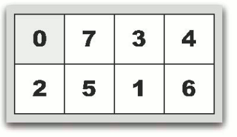
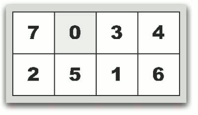
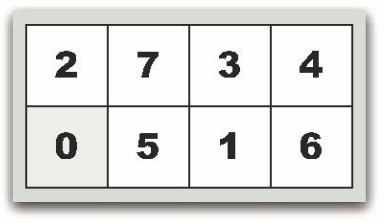
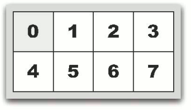

# 7 Puzzle

- CodeNet ID: `p00121`
- Dataset: `AIZU`
- Time limit: `1000 ms`
- Memory limit: `131072 KB`

A 7 Puzzle consists of 8 square cards and a frame that fits these cards exactly. Each card is numbered 0, 1, 2, ..., 7 so that they can be distinguished from one another. The frame can hold cards arranged in 2 rows and 4 columns.

To start the 7 Puzzle, first place all the cards into the frame. Within the frame, only the card numbered 0 can swap positions with a card adjacent to it horizontally or vertically. For example, when the state of the frame is as shown in Figure (a), swapping the card 0 with the card 7 adjacent to its right results in the state shown in Figure (b). Alternatively, from the state in Figure (a), swapping the card 0 with the card 2 adjacent below it results in the state shown in Figure (c). In the state of Figure (a), the only cards adjacent to card 0 horizontally or vertically are cards 7 and 2, so no other swaps are permitted.

The objective of the game is to arrange the cards neatly to reach the state shown in Figure (d). Given the initial state as input, create a program that outputs the minimum number of moves required to arrange the cards neatly. It is guaranteed that it is possible to reach the state in Figure (d) from the input card state.

The input data is given as 8 numbers separated by spaces on a single line. These represent the arrangement of the cards in the initial state. For example, the numerical representation of Figure (a) is `0 7 3 4 2 5 1 6`, and Figure (c) is `2 7 3 4 0 5 1 6`.









## Input

Multiple puzzles are given in the above format. Process until the end of the input.
The number of puzzles provided is 1,000 or fewer.

## Output

For each puzzle, output the minimum number of moves to transition to the final state on a single line.

## Sample Input 1

```text
0 1 2 3 4 5 6 7
1 0 2 3 4 5 6 7
7 6 5 4 3 2 1 0
```

## Output for the Sample Input 1

```text
0
1
28
```
