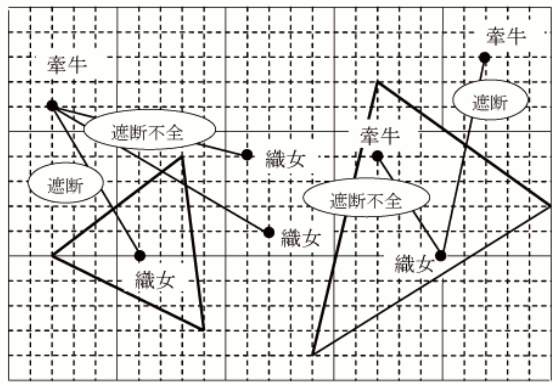

# Kengyu and Shokujo

- CodeNet ID: `p00143`
- Dataset: `AIZU`
- Time limit: `1000 ms`
- Memory limit: `131072 KB`

Shokujo was a child of the Heavenly Emperor, and by her father's command, she spent all her time weaving cloth.

The Heavenly Emperor's pleasure was wearing clothes made from the magnificent cloth called Unkin woven by Shokujo. Unkin has a short lifespan and deteriorates quickly, but since the hardworking Shokujo wove it every day, there was no problem. Because Shokujo obeyed her father's command and continued to weave Unkin day after day, she had no boyfriend. Feeling sorry for her, her father introduced her to a hardworking man named Kengyu, who lived on the opposite bank of the Milky Way, and let them marry.

Then, Shokujo became absorbed in the joy of marriage, neglecting her weaving and spending all her time playing with Kengyu. Consequently, the Heavenly Emperor's favorite Unkin clothes became tattered because they could not be newly tailored.

Enraged by this, the father wanted to bring Shokujo back to the palace. However, he could not appear before Kengyu, who is a human, wearing tattered clothes. He thought of blocking the two who were playing with a triangular wall, making it so that nothing other than himself could pass through. Then, without being spotted by Kengyu, he would meet Shokujo and declare that she must weave seriously, or otherwise be forcibly taken back.



To carry out this plan, the Heavenly Emperor decided to develop a triangular wall generation device. Given the positions of the three vertices of the triangle (xp1, yp1), (xp2, yp2), (xp3, yp3), the position of Kengyu (xk, yk), and the position of Shokujo (xs, ys), create a program that determines whether the triangle blocks Kengyu and Shokujo. If they are blocked, output OK; otherwise, output NG. In this context, "blocking" means that one of Kengyu or Shokujo is inside the triangle and the other is outside. It is guaranteed that Kengyu and Shokujo are not on the vertices or edges of the triangle.

Since Shokujo and Kengyu change their locations from moment to moment, the program must take various position information as input and answer the questions.

## Input

The input is given in the following format.

```text
n
query1
query2
:
queryn
```

In the first line, the number of pieces of information to be determined n (n ≤ 10000) is given, followed by n lines containing the i-th question queryi. Each question is given in the following format:

```text
xp1 yp1 xp2 yp2 xp3 yp3 xk yk xs ys
```

For each question, the positions of the three vertices of the triangle, the position of Kengyu, and the position of Shokujo (-1000 ≤ xp1, yp1, xp2, yp2, xp3, yp3, xk, yk, xs, ys ≤ 1000) are given on one line. All inputs are integers.

## Output

For each question, output the determination result OK or NG on one line.

## Sample Input 1

```text
5
2 5 9 2 8 9 2 11 6 5
2 5 9 2 8 9 2 11 12 6
2 5 9 2 8 9 2 11 11 9
14 1 25 7 17 12 17 9 20 5
14 1 25 7 17 12 22 13 20 5
```

## Output for the Sample Input 1

```text
OK
NG
NG
NG
OK
```
