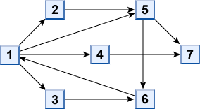

# パケット転送

- CodeNet ID: `p00144`
- Dataset: `AIZU`
- Time limit: `1000 ms`
- Memory limit: `131072 KB`

インターネットでは、データはパケットに分割され、パケットごとにルータと呼ばれる中継機器を介して宛先に転送されます。各ルータはパケットに記載された宛先から次に転送すべきルータを判断します。さらに、無限にルータ間を転送され続けることを防ぐため、パケットには TTL（Time To Live） という値が付加されています。ルータは受け取ったパケットの TTL を 1 減算し、その結果が 0 ならそのパケットを破棄し、それ以外なら次のルータに転送します。

そこで、ネットワークの設計を手助けするプログラムを作ることになりました。ネットワークの接続情報と送信パケットの情報を入力として、各パケットが宛先ルータに到着するまでに経由するルータの数のうち最小の値を表示するプログラムを作成してください。

ネットワークは図のように複数のルータとそれらを結ぶケーブルで構成されています。ただし、各接続（ケーブル）は単方向であることに注意してください。各ルータが直接つながっているルータの番号の配列がネットワークの接続の情報として与えられます。ルータの数を n とすれば、各ルータは 1 から n までの整数で識別されます。送信元から宛先ルータまでの経路が複数ある場合は、経由するルータの数が少ない方の値を出力してください。また、パケットが宛先に到達しない場合は NA と出力してください。

例えば、以下の図のようなネットワークで、送信元ルータが 6、宛先ルータが 5 の場合を考えます。最短経路は 6→1→5 であり経由するルータは 3 個です。この場合、TTL はルータ 6、1 でそれぞれ減算されるので、送信時の TTL が 3 以上であればパケットは到達できます。宛先ルータでは TTL を減算する必要はありません。また、送信元と宛先が同じルータになるようなパケットは無いものとします。



## Input

入力は以下の形式で与えられます。

```text
n
r1 k1 t11 t12 ... t1k1
r2 k2 t21 t22 ... t2k2
:
rn kn tn1 tn2 ... tnkn
p
s1 d1 v1
s2 d2 v2
:
sp dp vp
```

1 行目にルータの総数 n（n ≤ 100）、続く n 行に i 番目のルータの接続情報が与えられます。接続情報として、i 番目のルータの番号 ri、i 番目のルータと直接接続しているルータの個数 ki、i 番目のルータから送信できるルータの番号 ti1, ti2, ... tikiが与えられます。

続く行にパケットの個数 p（p ≤ 1000）、続く p 行に i 番目のパケットの情報が与えられます。パケットの情報として、 送信元ルータの番号 si, 宛先ルータの番号 di, TTL の値 vi (0 ≤ vi ≤ 10000) が与えられます。

## Output

各パケットごとに、経由するルータの個数または NA を１行に出力してください。

## Sample Input 1

```text
7
1 4 2 5 4 3
2 1 5
3 1 6
4 1 7
5 2 7 6
6 1 1
7 0
6
1 2 2
1 5 3
1 2 1
5 1 3
6 3 3
1 7 4
```

## Output for the Sample Input 1

```text
2
2
NA
3
3
3
```
