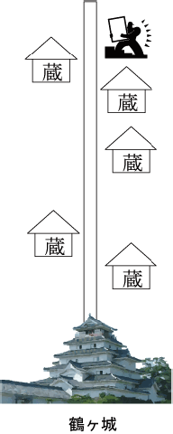

# Lupin IV

- CodeNet ID: `p00146`
- Dataset: `AIZU`
- Time limit: `1000 ms`
- Memory limit: `131072 KB`

The phantom thief "Lupin IV" is told by "Fujimine Mineko," a beautiful woman and descendant of the Aizu clan samurai, that military funds left by the Aizu clan are hidden in Aizu-Wakamatsu City. According to a report from Lupin's long-time companion "Ishikawa Echimon," the funds are contained in treasure chests (senryobako) and stored in several warehouses. There are no guards at the warehouses, but they are strictly locked. However, Echimon claims that if he uses the secret "Steel Cutting" technique passed down from his father, he can break into a warehouse instantly.



The remaining problem is the transport of the treasure chests. Lupin and Echimon, lacking physical strength, cannot carry a single treasure chest. Therefore, they asked the reliable man "Mugen Daisuke" to handle the transport.
To carry out all the treasure chests, Lupin devised the following plan:

First, Lupin drives to the first warehouse and drops off Echimon and Daisuke.

- Echimon breaks into the warehouse.
- Daisuke carries out all the treasure chests.
- While holding those treasure chests, they head to the next warehouse decided by Lupin.

This process is repeated until the last warehouse is broken into and the treasure chests are carried out. Meanwhile, Lupin prepares a helicopter and picks up the two men and the treasure chests at the last warehouse to escape. Daisuke can carry any weight, but his movement speed decreases depending on the weight of the luggage. Lupin must decide the order of breaking into the warehouses taking this into account.

On behalf of Lupin, please create a program that outputs the order of breaking into the warehouses such that the travel time from breaking into the first warehouse to reaching the last warehouse is minimized. Note that:

- All warehouses are facing a street that runs straight north from Tsuruga Castle. The number of warehouses is at most 15, and the distance from the castle is at most 10,000 meters.
- Each treasure chest weighs 20 kilograms. The number of treasure chests stored in each warehouse is 10,000 or fewer.
- Movement from warehouse to warehouse is done using underground passages installed beneath the street.
- To carry a load of $w$ kilograms, Daisuke moves at a speed of $2,000 / (70 + w)$ meters per minute.

The input data provides the warehouse number (an integer of 100 or less), the distance from the castle (meters), and the number of treasure chests stored in that warehouse for each warehouse.

## Input

The input is given in the following format:

```text
n
s1 d1 v1
s2 d2 v2
:
sn dn vn
```

In the first line, the number of warehouses $n$ ($n \le 15$) is given, followed by $n$ lines containing information for the $i$-th warehouse. The information for each warehouse consists of the warehouse number $s_i$ ($1 \le s_i \le 100$), the distance from the castle $d_i$ ($1 \le d_i \le 10000$), and the number of treasure chests $v_i$ ($1 \le v_i \le 10000$) given on one line.

## Output

Output the order of breaking into the warehouses on a single line. Separate the warehouse numbers with spaces.

## Sample Input 1

```text
2
1 100 1
2 200 2
```

## Output for the Sample Input 1

```text
1 2
```

## Sample Input 2

```text
3
11 100 1
13 200 20
12 300 3
```

## Output for the Sample Input 2

```text
11 12 13
```

## Sample Input 3

```text
5
13 199 1
51 1000 1
37 350 10
27 300 2
99 200 1000
```

## Output for the Sample Input 3

```text
51 37 27 13 99
```
