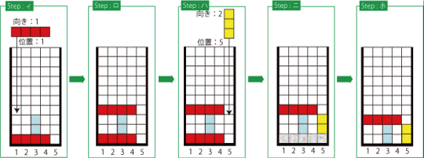
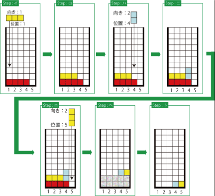

# Tetris

- CodeNet ID: `p00178`
- Dataset: `AIZU`
- Time limit: `1000 ms`
- Memory limit: `131072 KB`

Tetris is a game where falling blocks are arranged on a board and cleared. Here, let's consider a slightly modified version of that game.

The board size for this game is 5 units wide, with a height sufficient to accommodate all appearing blocks. The falling blocks are linear, coming in two orientations—horizontal and vertical—and five possible lengths from 1 to 5.

Examples are shown below. The diagrams from Step (イ) to Step (ホ) illustrate the process of blocks falling and being cleared. The process proceeds from Step (イ) to Step (ロ), then to Step (ハ), and so on.

When dropping a block, if any part of the block hits a block already stacked below, as seen in Step (イ), the falling block stops at that position, as shown in Step (ロ). Furthermore, if as a result of dropping a block, every unit in a single horizontal row of the board is filled, the blocks in that row are cleared, as shown in Step (ニ). After this, the blocks above the cleared row shift down by one row while maintaining their shape (Step (ホ)).



1. It is assumed that up to 1000 blocks fall in sequence. For example, if the lengths and orientations of the falling blocks are in the order: horizontal 4 units, horizontal 3 units, vertical 2 units, vertical 3 units, and the drop positions from the left edge are the 1st, 1st, 4th, and 5th units respectively, they will fall as shown in Step (イ) to (ト) in the figure below, and the remaining blocks at the end will be 2 units.



Given the information of the blocks falling in sequence as input, create a program that outputs the number of units remaining when all blocks have fallen.

## Input

A sequence of multiple datasets is given as input. The end of the input is indicated by a single line containing zero. Each dataset is given in the following format:

```text
n
d1 p1 q1
d2 p2 q2
:
dn pn qn
```

The first line contains the number of blocks $n$ ($1 \le n \le 1000$). The following $n$ lines contain the orientation $d_i$ (1 or 2), the length $p_i$ ($1 \le p_i \le 5$), and the position $q_i$ of the $i$-th block. For the orientation $d_i$, 1 represents horizontal and 2 represents vertical. The position $q_i$ is an integer from 1 to 5 from the left edge of the board; for horizontal blocks, this is the position where the leftmost unit falls.

The number of datasets does not exceed 20.

## Output

For each dataset, output the number of units occupied by the remaining blocks on a single line.

## Sample Input 1

```text
4
1 4 1
1 3 1
2 2 4
2 3 5
1
1 5 1
7
2 2 2
1 4 1
2 1 3
1 4 1
1 1 1
2 5 5
1 4 2
0
```

## Output for the Sample Input 1

```text
2
0
6
```
