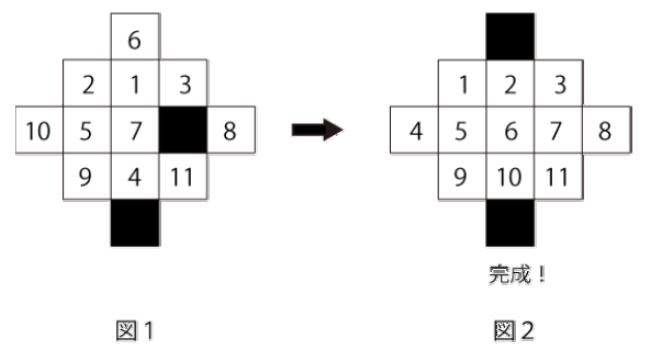

# 11 Puzzle

- CodeNet ID: `p00190`
- Dataset: `AIZU`
- Time limit: `5000 ms`
- Memory limit: `131072 KB`

Taro is very good at the 8-puzzle and always spends his break time playing with friends who shuffle the tiles for him. One day, a friend asked him, "Can you solve a more complex puzzle?" However, Taro has never tried any other puzzles. It seems that his friend had created their own "11-puzzle." The puzzle has the following shape:



The 11-puzzle is played using 11 square cards and a frame shaped as shown in Figure 1. First, the 11 cards are placed into the frame. This leaves two empty spaces, and cards adjacent to these empty spaces can be moved. The goal of the 11-puzzle is to repeat this process to arrange the cards neatly into the completed form shown in Figure 2.

Taro decided to take on this puzzle. However, Taro solved this 11-puzzle with ease. Consequently, his friend made an unreasonable request: "Solve it using the fewest number of moves!" Since Taro does not know the answer, he decided to ask you, who can program, to create a program that calculates the minimum number of steps to solve the 11-puzzle before he attempts it. In this puzzle, there are two places where moves can be made; moving one number by one space is counted as one step.

Please create a program that takes the initial state of the 11-puzzle as input and outputs the minimum number of steps to solve it. However, if the minimum number of steps to solve the puzzle exceeds 20 steps, output "NA". The state of the puzzle is input in the order of the information from the first line, where the number 0 represents an empty space. For example, the input representing the state in Figure 1 is as follows:

```text
6
2 1 3
10 5 7 0 8
9 4 11
0
```

## Input

A sequence of multiple datasets is given as input. The end of the input is indicated by a single line containing -1. Each dataset is given in the following format:

```text
p1
p2 p3 p4
p5 p6 p7 p8 p9
p10 p11 p12
p13
```

On the $i$-th line, the information for the $i$-th row of the puzzle $p_i$ ($0 \le p_i \le 11$) is given, separated by spaces.

The number of datasets does not exceed 100.

## Output

For each dataset, output the minimum number of steps or NA on a single line.

## Sample Input 1

```text
2
1 0 3
4 5 6 7 8
9 0 11
10
0
1 2 3
4 5 6 7 8
9 10 11
0
0
11 10 9
8 7 6 5 4
3 2 1
0
-1
```

## Output for the Sample Input 1

```text
2
0
NA
```
