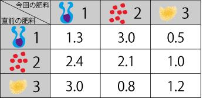
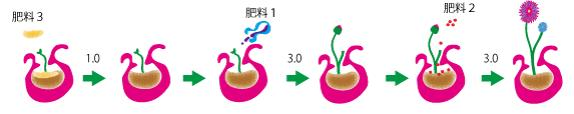

# Sapling

- CodeNet ID: `p00191`
- Dataset: `AIZU`
- Time limit: `1000 ms`
- Memory limit: `131072 KB`

Botanist Dr. Sato has invented many types of special fertilizers for saplings. When these fertilizers are applied to a sapling, its size changes instantly.
However, it has been discovered that the fertilizers have the following side effects:

- The first fertilizer applied alone does not change the size of the sapling.

- From the second time onwards, the sapling is affected by the combination of the fertilizer applied at that time and the fertilizer applied immediately before it. A positive effect makes the sapling grow, while a negative effect may cause the sapling to shrink.

As a trial, Dr. Sato investigated the growth rate of saplings based on the combination of the fertilizer applied at a certain point (current fertilizer) and the fertilizer applied immediately before it (previous fertilizer) for 3 types of fertilizers (Fertilizer 1, 2, and 3), and created the following "Growth Rate Table".

In the table on the right, the first row represents the number of the fertilizer to be applied this time, and the first column represents the number of the fertilizer applied immediately before. The other numbers indicate the growth rate (the ratio of the size after growth to the size before growth) of the sapling resulting from the combination of the previous fertilizer and the current fertilizer. A growth rate > 1.0 indicates that the sapling grows, and a growth rate < 1.0 indicates that the sapling shrinks. For example, applying Fertilizer 2 after Fertilizer 1 makes the sapling 3 times larger, but applying Fertilizer 3 after Fertilizer 1 shrinks the sapling to half its size.



If the number of times fertilizer is applied to the sapling is limited, which fertilizers should be applied in what order to grow the sapling as large as possible? The "Growth Rate Table" provides the answer. For example, if fertilizers are applied only 3 times using the fertilizers in the table above, the sapling grows the most if applied in the order of Fertilizer 3 $\to$ Fertilizer 1 $\to$ Fertilizer 2, as follows:



- With the 1st fertilizer (Fertilizer 3), the size of the sapling does not change.

- With the 2nd fertilizer (Fertilizer 1), the growth rate for Fertilizer 1 after Fertilizer 3 is 3.0 according to the table, so the size of the sapling becomes 3.0 times the previous size.

- With the 3rd fertilizer (Fertilizer 2), the growth rate for Fertilizer 2 after Fertilizer 1 is 3.0 according to the table, so the size of the sapling becomes another 3.0 times the previous size, resulting in $3.0 \times 3.0 = 9.0$ times the original size.

Now, Dr. Sato has investigated all $n$ types of fertilizers he invented and completed a "Growth Rate Table" like the one above, but the table has become very large, and he is struggling to determine the types of fertilizers and the order in which to apply them.

Therefore, on behalf of the doctor, please create a program that takes the growth rate values in the "Growth Rate Table" for combinations of $n$ types of fertilizers as input and finds the maximum size of the sapling after applying fertilizer $m$ times. Assume the initial size of the sapling is 1, and the growth rate of any fertilizer applied the first time is 1.0. The fertilizers are numbered from 1 to $n$.

## Input

A sequence of multiple datasets is given as input. The end of the input is indicated by two zeros on separate lines. Each dataset is given in the following format:

```text
n m
g11 g12 ... g1n
g21 g22 ... g2n
:
gn1 gn2 ... gnn
```

The first line contains the number of fertilizer types $n$ ($2 \le n \le 100$) and the number of times fertilizer is applied $m$ ($1 \le m \le 100$).

The following $n$ lines contain the growth rate $g_{ij}$ ($0.0 \le g_{ij} \le 10.0$, real number) when fertilizer $j$ is applied after fertilizer $i$.

The number of datasets does not exceed 20.

## Output

For each dataset, output the maximum size of the sapling on one line. The output size of the sapling should be rounded to the second decimal place (round the third decimal place).

## Sample Input 1

```text
3 3          
1.3 3.0 0.5 
2.4 2.1 1.0
3.0 0.8 1.2
2 2
1.0 1.0
1.0 1.0
0 0
```

## Output for the Sample Input 1

```text
9.00
1.00
```
