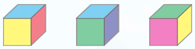
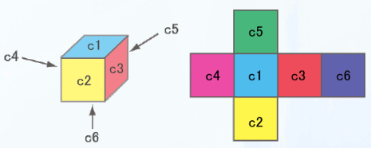

# Cube Artworks

- CodeNet ID: `p00198`
- Dataset: `AIZU`
- Time limit: `1000 ms`
- Memory limit: `131072 KB`

The artist Shinagawa was requested to exhibit $n$ pieces of artwork. He decided to exhibit cubes with their 6 faces painted. Each artwork uses all 6 colors—Red, Yellow, Blue, Magenta, Green, and Cyan—and each face is painted with a single color. Shinagawa created $n$ pieces by changing the arrangement of colors on cubes of the same shape to make them different artworks.



You, his friend, were allowed to view the artworks before the exhibition as a favor, but you noticed something. Among those artworks, there were cubes that appeared to have different colorings but were actually the same combination of colors (identical under rotation). If this continues, he will not be able to exhibit $n$ distinct pieces of artwork.

Create a program that takes the number of created artworks and the color information of each artwork as input, and outputs how many more pieces are needed to exhibit $n$ distinct artworks.

The colors of each face of the cube are represented by symbols $c_1$ to $c_6$, arranged as follows. Each of $c_1$ to $c_6$ is one of the colors Red, Yellow, Blue, Magenta, Green, or Cyan.



## Input

A sequence of multiple datasets is given as input. The end of the input is indicated by a single line containing zero.
Each dataset is given in the following format:

```text
n
cube1
cube2
:
cuben
```

On the first line, the number of artworks $n$ ($1 \le n \le 30$) is given, followed by $n$ lines containing the information for the $i$-th artwork. The information for each artwork is given in the following format:

```text
c1 c2 c3 c4 c5 c6
```

The color arrangement of the artwork $c_i$ is given separated by spaces.

The number of datasets does not exceed 100.

## Output

For each dataset, output the number of additional artworks needed to exhibit $n$ distinct pieces on a single line.

## Sample Input 1

```text
3
Cyan Yellow Red Magenta Green Blue
Cyan Yellow Red Magenta Green Blue
Red Yellow Magenta Blue Green Cyan
4
Red Magenta Blue Green Yellow Cyan
Red Yellow Magenta Blue Green Cyan
Magenta Green Red Cyan Yellow Blue
Cyan Green Yellow Blue Magenta Red
0
```

## Output for the Sample Input 1

```text
1
1
```
