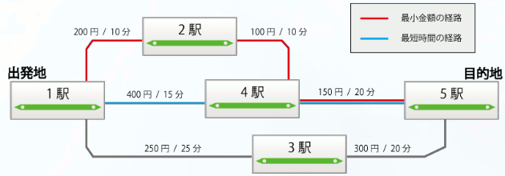

# One-Way Ticket of Youth

- CodeNet ID: `p00200`
- Dataset: `AIZU`
- Time limit: `1000 ms`
- Memory limit: `131072 KB`

Taro-kun is planning a long journey by train during his summer vacation. However, as a high school student with only one month of summer vacation, in order to travel as far as possible, he must find both the cheapest way and the fastest way to plan his trip successfully. Let's create a program to help Taro-kun's planning so that he can fully enjoy his wonderful journey.



Create a program that takes information about the tracks and the number of stations as input and outputs the minimum cost or the shortest time according to the queries.

## Input

A sequence of multiple datasets is given as input. The end of the input is indicated by two lines of zeros. Each dataset is given in the following format:

```text
n m
a1 b1 cost1 time1
a2 b2 cost2 time2
:
an bn costn timen
k
p1 q1 r1
p2 q2 r2
:
pk qk rk
```

On the first line, the number of track information $n$ ($1 \le n \le 3000$) and the number of stations $m$ ($1 \le m \le 100$) are given.

On the following $n$ lines, the information for the $i$-th route is given. For each route, the numbers of the two stations connected by the route $a_i, b_i$ ($1 \le a_i, b_i \le m$), the cost $cost_i$ ($1 \le cost_i \le 1000$), and the travel time $time_i$ ($1 \le time_i \le 1000$) are given. It is assumed that each station is numbered sequentially from 1 to $m$.

Note that if $a_i$ and $b_i$ are connected by a track, travel from $a_i$ to $b_i$ and from $b_i$ to $a_i$ is possible with the same cost and time.

On the following line, the number of queries $k$ ($1 \le k \le 200$) is given. On the following $k$ lines, the $i$-th query is given. For each query, the departure station $p_i$, the arrival station $q_i$, and the type of value to output $r_i$ (0 or 1) are given. It is guaranteed that a path always exists for each query.

The number of datasets does not exceed 50.

## Output

For each dataset, output the minimum cost or the shortest time on one line. When $r_i$ is 0, output the minimum cost; when $r_i$ is 1, output the shortest time.

## Sample Input 1

```text
6 5
1 2 200 10
1 4 400 15
1 3 250 25
2 4 100 10
4 5 150 20
3 5 300 20
2
1 5 0
1 5 1
0 0
```

## Output for the Sample Input 1

```text
450
35
```
