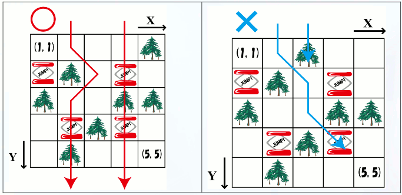

# New Project at Aizuyama Ski Resort

- CodeNet ID: `p00203`
- Dataset: `AIZU`
- Time limit: `1000 ms`
- Memory limit: `131072 KB`

Mr. Aburaki, the manager of Aizuyama Ski Resort, has prepared a course for advanced skiers featuring obstacles and jump ramps. There are various ways to ski the course, and any user who completes all possible skiing patterns during the season will receive a present.

For Mr. Aburaki, please create a program that outputs the number of skiing patterns based on the course map.



The course is represented by a grid of $X \times Y$ cells, as shown in the figure above. The origin is the top-left, where the $x$-coordinate increases to the right and the $y$-coordinate increases downwards.

Each skiing pattern starts from the highest point ($y = 1$, provided there is no obstacle) and proceeds toward the goal ($y = Y$). A skier at cell $(x, y)$ can move to any of $(x - 1, y + 1)$, $(x, y + 1)$, or $(x + 1, y + 1)$. Cells may contain obstacles or jump ramps. Cells with obstacles cannot be entered. If a skier enters a cell with a jump ramp, they are moved to $(x, y + 2)$. However, jump ramps do not exist in the highest cells ($y = 1$), and a cell with a jump ramp can only be entered from a cell with the same $x$-coordinate. A pattern is counted as one way of skiing if the skier starts from the top edge ($y = 1$) and passes the bottom edge ($y \ge Y$) without going out of the course bounds.

Create a program that takes the course information as input and outputs the total number of skiing patterns.

## Input

A sequence of multiple datasets is given as input. The end of the input is indicated by two zeros. Each dataset is given in the following format:

```text
X Y
c11 c21 ... cX1
c12 c22 ... cX2
:
c1Y c2Y ... cXY	
```

The first line contains the course dimensions $X, Y$ ($1 \le X, Y \le 15$). The following $Y$ lines contain the course information. $c_{ij}$ (either $0, 1, 	ext{ or } 2$) is an integer representing the information for the cell at $x = i, y = j$, where $0$ represents a traversable cell, $1$ represents a cell with an obstacle, and $2$ represents a cell with a jump ramp.

The number of datasets does not exceed 50.

## Output

For each input dataset, output the number of skiing patterns on a single line.

## Sample Input 1

```text
5 5
0 0 0 0 1
2 1 0 2 0
1 0 0 1 1
0 2 1 2 0
0 1 0 0 0
5 5
0 0 1 0 0
2 1 0 2 0
1 0 0 1 1
0 2 1 2 0
0 1 0 0 0
15 15
0 0 0 0 0 0 0 0 0 0 0 0 0 0 0
0 0 0 0 0 0 0 0 0 0 0 0 0 0 0
0 0 0 0 0 0 0 0 0 0 0 0 0 0 0
0 0 0 0 0 0 0 0 0 0 0 0 0 0 0
0 0 0 0 0 0 0 0 0 0 0 0 0 0 0
0 0 0 0 0 0 0 0 0 0 0 0 0 0 0
0 0 0 0 0 0 0 0 0 0 0 0 0 0 0
0 0 0 0 0 0 0 0 0 0 0 0 0 0 0
0 0 0 0 0 0 0 0 0 0 0 0 0 0 0
0 0 0 0 0 0 0 0 0 0 0 0 0 0 0
0 0 0 0 0 0 0 0 0 0 0 0 0 0 0
0 0 0 0 0 0 0 0 0 0 0 0 0 0 0
0 0 0 0 0 0 0 0 0 0 0 0 0 0 0
0 0 0 0 0 0 0 0 0 0 0 0 0 0 0
0 0 0 0 0 0 0 0 0 0 0 0 0 0 0
0 0
```

## Output for the Sample Input 1

```text
8
6
52694573
```
