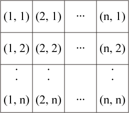
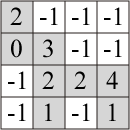
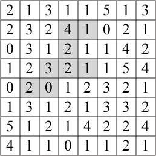

# What is the scenery in the photo?

- CodeNet ID: `p00209`
- Dataset: `AIZU`
- Time limit: `1000 ms`
- Memory limit: `131072 KB`

A-kun has come to Aizu for sightseeing. From the window of the hotel where he is staying, he can see a panoramic view of the Aizu Basin. While gazing at the scenery, he noticed a fragment of a photo lying on the floor. It seems that someone took a photo of the scenery outside the window. Wondering "Which part was taken?", A-kun began searching for a place where the photo matches the scenery outside the window by holding the photo up so that it is the same size as the scenery outside the window.

Now, let's have a computer do what A-kun is doing. Divide the scenery outside the window into an $n \times n$ grid of squares (where $n$ is called the size of the scenery). Each square contains a non-negative integer representing the image information of that square. The position of a square is represented by coordinates $(x, y)$. The coordinates of each square are as follows:



The fragment of the photo is represented by an $m \times m$ grid of squares (where $m$ is called the size of the photo fragment). Within this square, squares that are part of the fragment contain image information, and squares that are not part of the fragment contain -1. For example, in the figure below, the colored part represents the actual shape of the photo fragment. The fragment may have holes, but it is always connected. (If squares with values $\ge 0$ only touch at a vertex, they are considered not connected.) Also, squares with a value of -1 will not form a complete row or column from one end to the other.



Within the scenery visible from the window, search for a region that matches the photo fragment rotated by 0, 90, 180, or 270 degrees. For example, if the scenery is represented as shown below, rotating the fragment shown above 90 degrees counter-clockwise matches the colored region.



Given the information of the scenery visible from the window and the photo fragment as input, create a program that outputs the coordinates of the square closest to the top edge, and then closest to the left edge, among the squares of the region that matches the fragment rotated by 0, 90, 180, or 270 degrees.

If there are multiple matching regions, output the coordinates of the square that is closest to the top edge, and then closest to the left edge, among all the squares contained within those matching regions. If no matching region exists, output NA.

## Input

A sequence of multiple datasets is given as input. The end of the input is indicated by two lines of zeros. Each dataset is given in the following format:

```text
n m
w11 w12 ... w1n
w21 w22 ... w2n
:
wn1 wn2 ... wnn
p11 p12 ... p1m
p21 p22 ... p2m
:
pm1 pm2 ... pmm
```

On the first line, $n, m$ ($1 \le n \le 100, 1 \le m \le 50, m \le n$) are given.

Following this, $n$ lines contain the information of the scenery visible from the window $w_{ij}$ ($0 \le w_{ij} \le 15$), and the following $m$ lines contain the information of the photo fragment data $p_{ij}$ ($-1 \le p_{ij} \le 15$).

The number of datasets does not exceed 100.

## Output

For each input dataset, output the coordinates of the square's position or NA on one line.

## Sample Input 1

```text
8 4
2 1 3 1 1 5 1 3
2 3 2 4 1 0 2 1
0 3 1 2 1 1 4 2
1 2 3 2 1 1 5 4
0 2 0 1 1 3 2 1
1 3 1 2 2 4 3 2
5 1 2 1 4 1 1 5
4 1 1 0 1 2 2 1
2 -1 -1 -1
0 3 -1 -1
-1 2 2 4
-1 1 -1  1
5 3
1 0 2 3 5
2 3 7 2 1
2 5 4 2 2
8 9 0 3 3
3 6 0 4 7
-1 -1 2
-1 3 5
0 4 -1
0 0
```

## Output for the Sample Input 1

```text
4 2
NA
```
