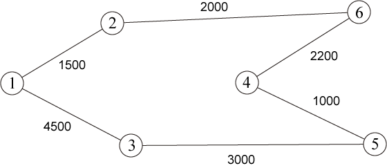

# Highway Bus

- CodeNet ID: `p00212`
- Dataset: `AIZU`
- Time limit: `1000 ms`
- Memory limit: `131072 KB`

Student A is planning a solo trip by highway bus (hereafter referred to as "bus") during his high school break. First, Student A chose the town he most wants to visit as his destination. Next, he must decide on a route from his starting point to the destination by transferring between buses. When transferring, he gets off one bus and boards another, so a ticket is required for each bus.

Student A received several bus discount coupons from his uncle. Using one of these coupons allows him to purchase one ticket at half price. For example, to go from starting point 5 to destination 1 as shown in Figure 1, two paths can be considered: 5→4→6→2→1 and 5→3→1. If he has 2 discount coupons, to make the transportation cost the cheapest, if he takes the path 5→4→6→2→1, he would use discounts on the 4→6 and 6→2 routes, resulting in a total cost of 4600 yen. On the other hand, if he takes the path 5→3→1, he would use discounts on the 5→3 and 3→1 routes, resulting in a total cost of 3750 yen.

Student A wants to spend more money on sightseeing, so he intends to keep the transportation cost as low as possible. Therefore, Student A decided to create a program to find the cheapest transportation cost from the starting point to the destination.



Please create a program that takes the number of discount coupons, the number of towns connected by buses, the number of bus routes, and the information for each bus route as input, and outputs the cheapest transportation cost from the starting point to the destination. Each bus operates bidirectionally with the same fare. Also, if the number of towns is $n$, each town is assigned a unique number from 1 to $n$. It is guaranteed that a path from the starting point to the destination always exists.

## Input

A sequence of multiple datasets is given as input. The end of the input is indicated by five lines of zeros.
Each dataset is given in the following format:

```text
c n m s d
a1 b1 f1
a2 b2 f2
:
am bm fm
```

The first line contains the number of discount coupons $c$ ($1 \le c \le 10$), the number of towns connected by buses $n$ ($2 \le n \le 100$), the number of bus routes $m$ ($1 \le m \le 500$), the starting town number $s$, and the destination town number $d$ ($s \neq d$).

The following $m$ lines contain the information for the $i$-th bus route $a_i, b_i, f_i$ ($1 \le a_i, b_i \le n, 1000 \le f_i \le 10000$). $a_i$ and $b_i$ are the town numbers of the start and end points of the bus route, and $f_i$ is an integer in increments of 100 representing the fare of this route.

The number of datasets does not exceed 100.

## Output

For each input dataset, output the cheapest transportation cost on a single line.

## Sample Input 1

```text
1 3 3 1 3
1 3 2000
1 2 1000
2 3 1000
2 3 3 1 3
1 3 2300
1 2 1000
2 3 1200
2 6 6 5 1
1 2 1500
1 3 4500
2 6 2000
5 4 1000
6 4 2200
3 5 3000
0 0 0 0 0
```

## Output for the Sample Input 1

```text
1000
1100
3750
```
