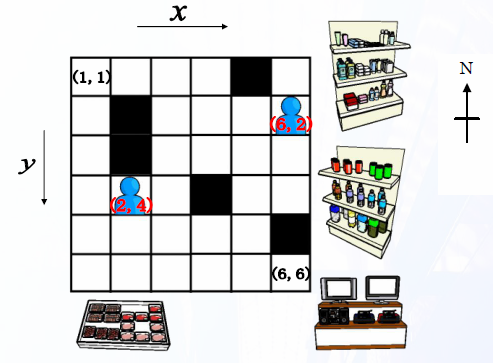

# Lost Twins

- CodeNet ID: `p00223`
- Dataset: `AIZU`
- Time limit: `5000 ms`
- Memory limit: `131072 KB`

Takayuki and Kazuyuki are close twins, but their actions are exactly opposite. For example, if Takayuki moves west, Kazuyuki moves east; if Kazuyuki moves north, Takayuki moves south. Currently, the two of them are at a department store and are in different locations. What should they do to meet as quickly as possible, given that they move in opposite directions?

The department store is represented as a grid consisting of W columns and H rows, and both can move one square east, west, north, or south per unit time. However, they cannot move outside the grid boundaries or into squares containing obstacles.

As shown in the figure, the position of a square in the grid is represented by coordinates (x, y).



Given the grid information and the initial positions of the two, create a program that outputs the shortest time until the two meet. If they cannot meet, or if it takes 100 or more units of time to meet, output NA. The grid information is given as H rows and W columns of digits, and the positions of the two are given as coordinates.

If, after a move, either Takayuki or Kazuyuki ends up in an obstacle or outside the grid boundaries, that person cannot move and returns to their original position; however, the other person can move without returning to their original position if they are not in an obstacle or outside the grid boundaries.

Note that "meeting" means that after a move, both people stop on the same square. If the two pass each other, it is not considered meeting.

## Input

A sequence of multiple datasets is given as input. The end of the input is indicated by two lines of zeros.
Each dataset is given in the following format:

```text
W H
tx ty
kx ky
d11 d21 ... dW1
d12 d22 ... dW2
:
d1H d2H ... dWH
```

The first line contains the size of the department store W, H (1 ≤ W, H ≤ 50). The second line contains Takayuki's initial position tx, ty, and the third line contains Kazuyuki's initial position kx, ky.

The following H lines contain the information of the department store. di,j represents the type of square (i, j), where 0 represents a traversable square and 1 represents a square with an obstacle.

The number of datasets does not exceed 100.

## Output

For each input dataset, output the shortest time on a single line.

## Sample Input 1

```text
6 6
2 4
6 2
0 0 0 0 1 0
0 1 0 0 0 0
0 1 0 0 0 0
0 0 0 1 0 0
0 0 0 0 0 1
0 0 0 0 0 0
3 3
1 1
3 3
0 0 0
0 1 0
0 0 0
0 0
```

## Output for the Sample Input 1

```text
3
NA
```
