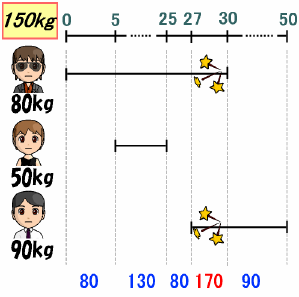

# 危ない橋

- CodeNet ID: `p00231`
- Dataset: `AIZU`
- Time limit: `1000 ms`
- Memory limit: `131072 KB`

会津若松市よりずっと北に位置する会津古松村では、「ヤ橋(やばし) 」と呼ばれる橋が周辺の村へ移動する唯一の手段となっています。その橋は通行人が多いにも関わらず、今にも壊れそうなほど老朽化が進んでしまっています。



ヤ橋は 150 [kg] まで耐えられる強度を持っています。例えば、80 [kg] の人と 50 [kg] の人が同時に渡ることはできますが、80 [kg] の人が渡っているときに 90 [kg] の人が渡り始めると、ヤ橋は壊れてしまいます。

もしヤ橋が壊れてしまったら、会津古松村の人々は周辺の村へ移動する手段を失ってしまいます。そこで、村で唯一のプログラマーであるあなたは、村民の生活を守るために、橋の渡り方から橋が壊れるか否かを判定するプログラムを作成することにしました。

橋を渡る通行人の人数 n (1 ≤ n ≤ 100)、各通行人の体重 mi (1 ≤ mi ≤ 100)、橋を渡り始める時刻 ai、渡り終える時刻 bi (0 ≤ ai, bi < 231) を入力とし、橋が壊れない場合は“OK ”と出力し、壊れる場合は“NG ”と出力するプログラムを作成してください。なお、橋の上にいる通行人の体重の総和が 150 [kg] を超えてしまうとヤ橋は壊れてしまいます。また、ai の時点で通行人は橋の上にいますが、bi の時点では橋の上にいません。

## Input

複数のデータセットの並びが入力として与えられます。入力の終わりはゼロひとつの行で示されます。各データセットは以下の形式で与えられます。

```text
n
m1 a1 b1
m2 a2 b2
:
mn an bn
```

データセットの数は 1200 を超えません。

## Output

入力データセットごとに、橋が壊れるか否かを1行に出力します。

## Sample Input 1

```text
3
80 0 30
50 5 25
90 27 50
3
80 0 30
70 5 25
71 30 50
0
```

## Output for the Sample Input 1

```text
NG
OK
```
