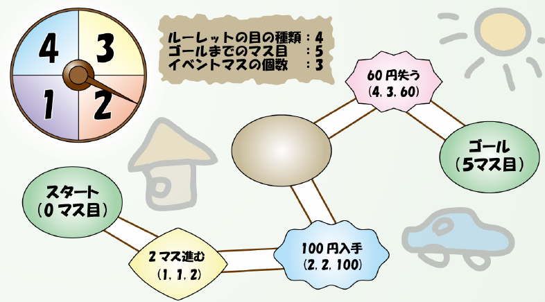
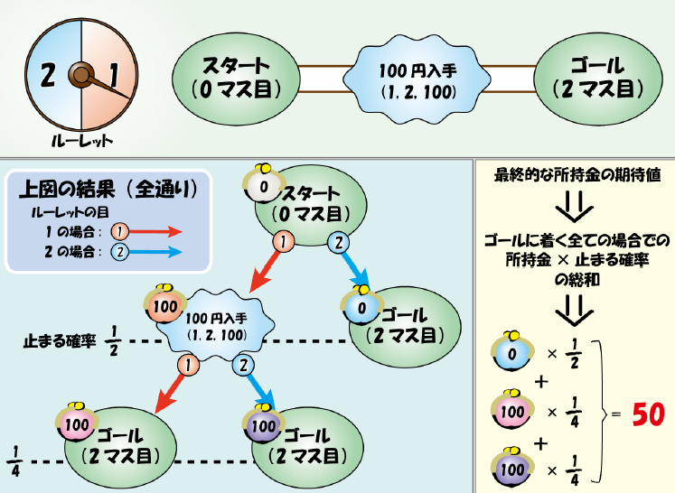

# Game of Life

- CodeNet ID: `p00232`
- Dataset: `AIZU`
- Time limit: `1000 ms`
- Memory limit: `131072 KB`

Taro went to a toy store to buy a Game of Life produced by Aizu Hobby. The Game of Life is played using a board with squares and a roulette wheel. As shown in the figure, the board has one start point and one goal point, connected by a single sequence of squares. Initially, a piece is placed on the start square, and the piece advances by the number rolled on the roulette wheel. Depending on the square, there are event squares where stopping or passing through may result in gaining money or changing the piece's position.



The interesting thing about this company's Game of Life is that the values on the roulette wheel, the number of squares to the goal, and the placement of event squares differ for every single package. These are written on the case and can be confirmed by reading them. Taro wants to choose the Game of Life that allows him to obtain the most money, so he wants to buy the one with the highest expected value of money gained. Therefore, you decided to help Taro choose his game.

Assume the roulette wheel is divided into $X$ equal parts around the circumference, with values $V_1, V_2, \dots, V_X$ written on each. The board consists of squares numbered $0, 1, \dots, Y$ in sequence. Among these squares, there are $Z$ special squares called event squares, which trigger a special action when reached. The square numbers of the event squares are given as $N_i$. Event squares have types $E_i$ from 1 to 3, and each performs the following action:

- Type 1: Gain $A_i$ yen.
- Type 2: Lose $A_i$ yen.
- Type 3: Move the piece to square $A_i$.

The initial amount of money is 0 yen, and the game starts from square 0. Reaching square $Y$ is considered the goal. If the piece moves beyond the goal, it is also considered to have reached the goal. There are no events at the start or goal, and multiple events do not overlap on a single square. Events triggered by moving to a square via another event are ignored. If the amount of money becomes less than 0 yen, it is treated as 0 yen.

For example, the expected value of money obtained in a certain Game of Life can be calculated as follows:



In this example, the Game of Life consists of three squares—the start, an event square (gain 100 yen), and the goal—and a roulette wheel that results in either 1 or 2. First, when the roulette is spun for the first time, if a 1 is rolled, the piece reaches the event square and the money becomes 100 yen. On the other hand, if a 2 is rolled, the piece reaches the goal and the money remains 0 yen. Both of these occur with a probability of $1/2$.

Furthermore, if the event square was reached on the first turn, the roulette is spun a second time; regardless of the value rolled, the piece reaches the goal, and the money is 100 yen in all such cases.

In this way, there are a total of 3 ways to reach the goal. Focusing on the money held at the time of reaching the goal, there is 1 case where it is 0 yen with a probability of $1/2$, and 2 cases where it is 100 yen with a total probability of $1/4 + 1/4 = 1/2$. In this case, the expected value of money at the goal is the sum of (money $\times$ its probability) for each way of reaching the goal, and the expected value for this Game of Life is 50 yen.

Write a program that takes the roulette information and board information as input and outputs the expected value of the money held at the goal.

## Input

A sequence of multiple datasets is given as input. The end of the input is indicated by three lines of zeros. Each dataset is given in the following format:

```text
X Y Z
V1 V2 ... VX
N1 E1 A1
N2 E2 A2
:
NZ EZ AZ
```

$X$ ($1 \le X \le 4$), $V_i$ ($1 \le V_i \le 10$), $Y$ ($1 \le Y \le 50$), $N_i$ ($1 \le N_i \le Y-1$), $Z$ ($0 \le Z \le Y-1$), $E_i$ ($1 \le E_i \le 3$), $A_i$ ($1 \le A_i \le 100$) are given as integers.

The number of datasets does not exceed 100.

## Output

For each input dataset, output the expected value of the final money on one line. The expected value should be output as an integer, truncated to the floor (rounded down).

## Sample Input 1

```text
1 2 0
1
1 2 1
1
1 2 100
1 2 1
2
1 2 100
2 2 1
1 2
1 2 100
4 5 3
1 2 3 4
1 1 2
2 2 100
4 3 60
0 0 0
```

## Output for the Sample Input 1

```text
0
100
0
50
20
```
