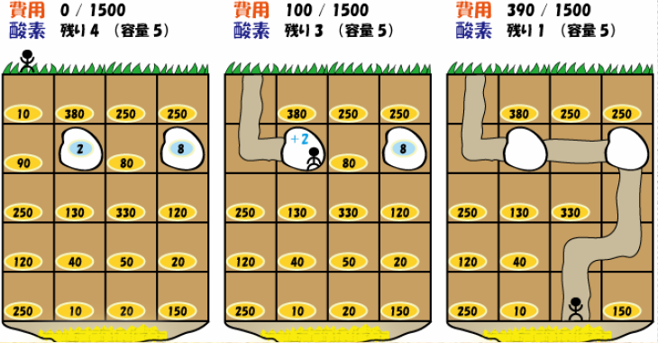

# Aizu's Buried Treasure

- CodeNet ID: `p00234`
- Dataset: `AIZU`
- Time limit: `1000 ms`
- Memory limit: `131072 KB`

There is an ancient legend of buried treasure in Aizu. You have finally pinpointed the location where the treasure is buried. Since you know the depth at which the treasure is buried and the state of the geological strata you must dig through, you can reach the treasure with minimum cost if you plan carefully. Therefore, you decided to create a program that reads the state of the strata and calculates the route to reach the depth of the buried treasure with the minimum cost.

The state of the strata is represented by cells arranged in a 2D grid, where the position of each cell is represented by coordinates $(x, y)$. The top-left is $(1, 1)$, the $x$-coordinate increases as you move right, and the $y$-coordinate increases as you go deeper.

You choose one of the cells with the smallest $y$-coordinate to start digging and proceed until you reach one of the cells with the largest $y$-coordinate. There are two types of cells in the strata:

- Cells filled with soil: Digging these costs a specific amount determined for each cell.
- Cells filled with oxygen: These do not need to be dug, and you can replenish a specific amount of oxygen determined for each cell. Once oxygen is replenished from a cell, it is gone and cannot be replenished again. Furthermore, if you reach such a cell, you must replenish the oxygen.

From a certain cell, you can only dig into cells to the left, right, or downward.
Once a cell has been dug, you can move left or right within it, but you cannot move upward.

During the excavation, you must carry an oxygen tank. The moment the remaining oxygen in the tank becomes 0, you can no longer move, dig, or replenish oxygen. The remaining amount decreases by 1 every time you move to a cell. Even if you reach the depth where the treasure is buried with 0 oxygen remaining, it is not considered as having reached the destination. Additionally, while you can replenish oxygen at oxygen-filled cells, any amount exceeding the tank's capacity is discarded.

Given the size of the strata, your excavation budget, the oxygen tank capacity, the initial amount of oxygen you possess, and the information about the strata, create a program that outputs the minimum cost to reach the deepest cell. However, if the minimum cost exceeds your excavation budget or if it is impossible to reach the buried treasure regardless of how you dig, output "NA".



## Input

Multiple datasets are provided as input. The end of the input is indicated by two lines of zeros.
Each dataset is given in the following format:

```text
W H
f m o
c1,1 c2,1 ... cW,1
c1,2 c2,2 ... cW,2
...
c1,H c2,H ... cW,H
```

The first line contains the horizontal size of the strata $W$ and the vertical size $H$ ($3 \le W, H \le 10$).
The second line contains an integer $f$ representing your excavation budget ($1 \le f \le 10000$), an integer $m$ representing the oxygen tank capacity ($3 \le m \le 50$), and an integer $o$ representing the initial amount of oxygen you possess ($o \le m$).

The following $H$ lines contain the strata information $c_{i,j}$. $c_{i,j}$ represents the information for the cell at coordinates $(i, j)$ and is given in the following format:
- If the value is negative, it is a cell filled with soil, and the absolute value represents the cost.
- If the value is positive, it is a cell filled with oxygen, and the value represents the amount of oxygen.
Note that there are no more than 50 oxygen-filled cells.

The number of datasets does not exceed 50.

## Output

For each dataset, output the minimum cost or "NA" on a single line.

## Sample Input 1

```text
3 3
100 10 10
-100 -20 -100
-100 -20 -100
-100 -20 -100
3 3
100 10 10
-100 -20 -100
-100 -20 -20
-100 -60 -20
3 3
100 10 3
-100 -20 -100
-20 -20 -20
-20 -100 -20
3 3
100 3 3
-100 -20 -30
-100 -20 2
-100 -20 -20
4 5
1500 5 4
-10 -380 -250 -250
-90 2 -80 8
-250 -130 -330 -120
-120 -40 -50 -20
-250 -10 -20 -150
0 0
```

## Output for the Sample Input 1

```text
60
80
NA
50
390
```
