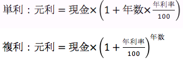
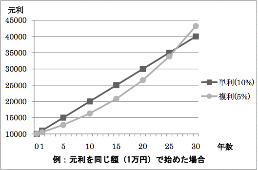

# 金利計算

- CodeNet ID: `p00240`
- Dataset: `AIZU`
- Time limit: `1000 ms`
- Memory limit: `131072 KB`

金利は銀行に預けているお金に付き、その計算方法や利率は銀行によって様々です。利息と元金を合わせたものを元利と呼びますが、元利の計算方法として、利息を元金に組み入れずに計算する「単利」と利息を元金に組み入れて計算する「複利」というものがあり、より多くの元利を得るためにはこの差異を理解していなければなりません。元利の計算方法は以下のようになります。





銀行の数、お金を預ける年数、各銀行の情報（銀行番号、金利の種類、年利率（パーセント））を入力とし、最も元利が高くなる銀行番号を出力するプログラムを作成してください。ただし、最も元利が高くなる銀行は一つだけです。

## Input

複数のデータセットが与えられます。入力の終わりはゼロひとつで示されます。各データセットは以下の形式で与えられます。

```text
n
y
b1 r1 t1
b2 r2 t2
:
bn rn tn
```

1行目に銀行の数 n (1 ≤ n ≤ 50)、2行目にお金を預ける年数 y (1 ≤ y ≤ 30)が与えられます。続くn 行に i 番目の銀行の銀行番号 bi、年利率を表す整数 ri (1 ≤ ri ≤ 100)、 金利の種類 ti (1 または 2) が与えられます。金利の種類 ti は、単利の場合は1、複利の場合は2で与えられます。

データセットの数は 100 を超えません。

## Output

データセットごとに、最も元利が高くなる銀行番号を１行に出力します。

## Sample Input 1

```text
2
8
1 5 2
2 6 1
2
9
1 5 2
2 6 1
0
```

## Output for the Sample Input 1

```text
2
1
```
