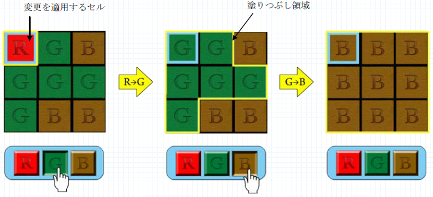

# 塗りつぶしゲーム

- CodeNet ID: `p00243`
- Dataset: `AIZU`
- Time limit: `3000 ms`
- Memory limit: `131072 KB`

指で画面にタッチして操作することのできるタブレットインターフェースの技術は、ゲームの分野でも応用され、新しい操作感を持つ様々な種類のゲームが作られています。現在、ＡＺ社が開発しているゲームもその一つです。

このソフトウェア（ゲーム）の要件は以下の通りです。

- 画面には X 列× Y行の2次元グリッドがあります。

- グリッドのセルは赤(R)、緑(G)、茶(B)の3色のいずれかで塗られています。

- セルの色を変更するボタンR、G、Bがあり、このボタンが押下されると一番左上(0,0)のセルがその色に変更されます。

- 一番左上のセルの色が変更されると、そのセルの元の色と同じ色に塗られた隣接するすべてのセルが指定された色に変わります。すなわち、元の色が同じ色のセルでつながったセルはすべて指定された色に変更されます。

このようにグリッドを塗りつぶしていき、最終的にグリッド全体を一色にするというゲームです。少ない手順で解くと高得点が与えられます。

ＡＺ社のプログラマーであるあなたは、このゲームのロジックの一部分を開発することになりました。まずは、この最高得点を計算するため、このゲームを最短で解いた場合、最低何回選択ボタンを操作すればグリッドが一色になるかをもとめるプログラムを作ることにしました。



## Input

複数のデータセットが与えられます。入力の終わりはゼロふたつで示されます。各データセットは以下の形式で与えられます。

```text
X Y
c1,1 c2,1 ... cX,1
c1,2 c2,2 ... cX,2
:
c1,Y c2,Y ... cX,Y
```

1行目にグリッドの列と行のサイズ X, Y (2 ≤ X, Y ≤ 10) が与えられます。続く Y 行に i 列目 j 行目のセルの色を表す文字 ci,j が空白区切りで与えられます。

## Output

データセットごとに、ボタン操作の最少回数を1行に出力します。

## Sample Input 1

```text
3 3
R G B
G G G
G B B
2 4
R G
G G
R B
B R
4 3
G G B R
G R R G
B G G R
0 0
```

## Output for the Sample Input 1

```text
2
4
4
```
