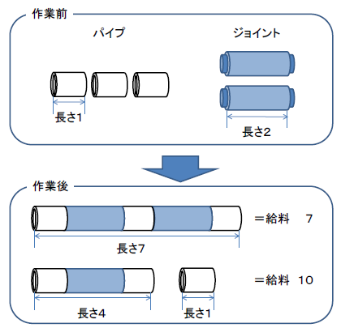

# Pipe Connector's Salary

- CodeNet ID: `p00255`
- Dataset: `AIZU`
- Time limit: `1000 ms`
- Memory limit: `131072 KB`

I am a pipe connector. As long as I am given joints and pipes, I can connect any kind of pipe. Every day, my boss gives me pipes and joints, and I connect them and hand them back to him. However, when there are too many pipes, I cannot connect them all in a single day. Even then, my boss smiles and gives me my salary.

By the way, I noticed something strange. It often happens that I receive a higher salary when I cannot connect all the pipes than when I can. Because it was so strange, one day when my boss arrived, I secretly looked at a memo that described how the salary is calculated. To my surprise, it said:

"The salary is paid as 'the number of pipes × the total sum of the lengths of the pipes'. However, if pipes are connected by joints to form a single continuous piece, that piece is considered as one pipe."

Now I understand why connecting everything can sometimes result in a lower salary. For example, as shown in the figure below, if you connect three pipes of length 1 and two joints of length 2, you get one pipe of length 1+2+1+2+1 = 7, so the salary is 1 × (7) = 7. However, if you use only one joint to create two pipes—one of length 1+2+1 = 4 and one of length 1—the salary is 2 × (4+1) = 10, which is much more than connecting them all.



I don't know why my boss decides the salary this way, but now I know how to maximize the salary I receive!

Please create a program that calculates the maximum possible salary given the number of pipes.

## Input

The input consists of multiple datasets. The end of the input is indicated by a single line containing zero. Each dataset is given in the following format:

```text
n
p1 ... pn
j1 ... jn-1
```

The first line contains the number of pipes $n$ ($2 \le n \le 65000$). The second line consists of $n$ integers separated by spaces; $p_i$ ($1 \le p_i \le 1000$) represents the length of the $i$-th pipe. The third line consists of $n-1$ integers separated by spaces; $j_i$ ($1 \le j_i \le 1000$) represents the length of the $i$-th joint.

The $i$-th joint can only connect the $i$-th and $(i+1)$-th pipes. The length of the connected pipes becomes $p_i + j_i + p_{i+1}$.

The number of datasets does not exceed 100.

## Output

For each dataset, output the maximum possible salary on one line. For the datasets given as input, the output value will always fit within the range of a 32-bit unsigned integer.

## Sample Input 1

```text
3
1 1 1
3 3
4
3 3 3 3
1 1 1
5
1 2 3 4 5
4 3 2 1
0
```

## Output for the Sample Input 1

```text
12
48
76
```
