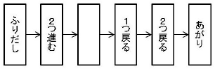

# Making a Sugoroku

- CodeNet ID: `p00257`
- Dataset: `AIZU`
- Time limit: `3000 ms`
- Memory limit: `131072 KB`

Taro has made a Sugoroku (a board game similar to Snakes and Ladders) so that everyone can play together at a children's association event. To make the game interesting, he wrote instructions such as "move forward 6 spaces" or "move back 5 spaces" on some of the spaces other than the "Start" and "Goal". A player spins a roulette, moves forward by the number that comes up, and if the space they land on has an instruction, they follow that instruction to move. However, they do not follow the instruction of the space they land on after following an instruction.

Assume the roulette can produce any integer from 1 up to a certain number with equal probability. Additionally, if a number is rolled that would move the player beyond the "Goal", or if following an instruction would move the player beyond the "Goal", the player moves to the "Goal". If following an instruction would move the player before the "Start", the player moves back to the "Start".



However, depending on the roulette and the instructions on the spaces, there are cases where the "Goal" cannot be reached. For example, suppose a Sugoroku is made as shown in the figure. If a roulette that only produces 1 and 2 is used, the player can reach the "Goal" if 1 and then 2 are rolled, but if 2 is rolled first, they will never reach the "Goal" regardless of what is rolled thereafter. Taro, unaware of this, enthusiastically wrote instructions on various spaces.

Therefore, on behalf of Taro, please create a program that determines whether there are cases where the "Goal" cannot be reached, depending on the roulette and the instructions on the spaces.

## Input

The input consists of multiple data sets. The end of the input is indicated by a single line containing zero. Each data set is given in the following format:

```text
max
n
d1
d2
.
.
.
dn
```

On the first line, the maximum value the roulette can produce, `max` (2 ≤ `max` ≤ 250), is given. On the second line, the number of spaces other than "Start" and "Goal", `n` (2 ≤ `n` ≤ 250), is given. In the following `n` lines, the number `di` (-n ≤ `di` ≤ n) representing the instruction for each space is given. If `di` is zero, it means there is no instruction; if it is a positive number, it is an instruction to move forward |`di`| spaces; if it is a negative number, it is an instruction to move back |`di`| spaces (here, |x| denotes the absolute value of x). All input values are integers.

The number of data sets does not exceed 100.

## Output

For each data set, output the result of the determination on one line. If there are cases where the "Goal" cannot be reached depending on the roulette and the instructions on the spaces, output "NG"; otherwise, output "OK".

## Sample Input 1

```text
3
3
-2
1
0
2
4
2
0
-1
-2
2
2
-2
-2
0
```

## Output for the Sample Input 1

```text
OK
NG
NG
```
