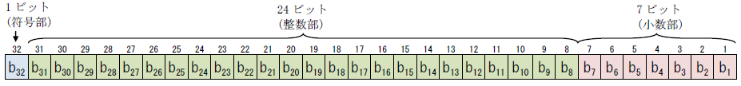
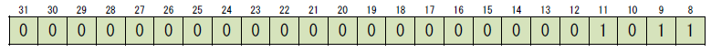
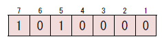
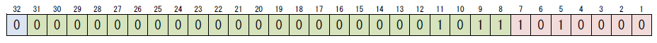
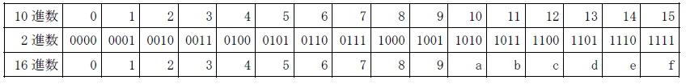

# Kongo's Format

- CodeNet ID: `p00263`
- Dataset: `AIZU`
- Time limit: `1000 ms`
- Memory limit: `131072 KB`

Consider a 32-bit real number type where the rightmost 7 bits are the fractional part, the following 24 bits are the integer part, and the leftmost 1 bit is the sign bit (where $b_1, \dots, b_{32}$ represent 0 or 1).



When converting this format into a human-readable decimal representation, it is interpreted as follows:
$(-1)^{\text{sign bit}} \times (\text{integer part} + \text{fractional part})$

In the above expression, the value of the integer part is $b_8 + 2^1 \times b_9 + 2^2 \times b_{10} + \dots + 2^{23} \times b_{31}$. For example, if the integer part is as follows:



the value of the integer part is calculated as follows:
$1 + 2^1 + 2^3 = 1 + 2 + 8 = 11$

On the other hand, the value of the fractional part is $(0.5)^1 \times b_7 + (0.5)^2 \times b_6 + \dots + (0.5)^7 \times b_1$. For example, if the fractional part is as follows:



the fractional part is calculated as follows:
$0.5^1 + 0.5^3 = 0.5 + 0.125 = 0.625$

Furthermore, in the case of a bit string combining the sign bit, integer part, and fractional part as follows:



the decimal number represented by the entire bit string is as follows (note that $(-1)^0 = 1$):
$(-1)^0 \times (1 + 2 + 8 + 0.5 + 0.125) = 1 \times (11.625) = 11.625$

Given $Q$ 32-bit bit strings as input, create a program that outputs the decimal representation of the real numbers represented by those bit strings without any error.

## Input

The input consists of a single data set. The input data is given in the following format:

```text
Q
s1
s2
.
.
.
sQ
```

The first line contains the number of bit strings $Q$ ($1 \le Q \le 10000$). The following $Q$ lines contain the input bit strings $s_i$. The input bit strings are given in hexadecimal notation (e.g., `0111 1111 1000 1000 0000 0000 0000 0000` is given as `7f880000`). That is, each of the $Q$ lines contains 8 hexadecimal digits (each representing 4 bits of a binary number) concatenated without spaces. The correspondence between decimal, binary, and hexadecimal is shown in the table below.



Hexadecimal letters 'a' through 'f' are given in lowercase.

## Output

Output the decimal representation of the real number represented by each bit string on a separate line. However, in the fractional part, if all digits from a certain position onwards are 0, those digits should be omitted; as an exception, if the fractional part is 0, output a single 0 for the fractional part.

## Sample Input 1

```text
8
00000000
80000000
00000080
00000040
000000c0
00000100
80000780
80000f70
```

## Output for the Sample Input 1

```text
0.0
-0.0
1.0
0.5
1.5
2.0
-15.0
-30.875
```
