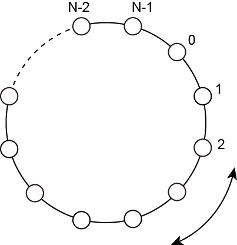

# 鉄道路線II

- CodeNet ID: `p00294`
- Dataset: `AIZU`
- Time limit: `1000 ms`
- Memory limit: `131072 KB`

わたしの住む街には、図のような N 個の駅からなる円環状の鉄道路線があります。この路線の各駅には 0 から N-1 までの番号が順番に割り当てられていて、隣の駅まで100 円で移動することができます。移動はどちらの方向にでも可能です。



わたしはこの路線上のいくつかの駅で買い物をしたいと思っています。そこで、プログラムを作成して移動費を計算することにしました。ある駅を始点として、買い物をするすべての駅を訪問する最小の費用（円）を求めるプログラムを作成してください。ただし、同じ駅を何度訪問しても良く、どのような順番で駅を訪問しても構いません。

## Input

入力は以下の形式で与えられる。

```text
N M p
d1
d2
:
dM
```

1行目に駅の数 N (2 ≤ N ≤ 100000)、買い物をする駅の数 M (1 ≤ M ≤ 10000 かつ M < N)、出発する駅の番号 p (0 ≤ p ≤ N-1) が与えられる。続く M 行に買い物をする駅の番号 di (0 ≤ di ≤ N-1) が与えられる。ただし、diは全て異なり、p もまたどの di とも異なるものとする。

## Output

最小の費用を１行に出力する。

## Sample Input 1

```text
5 4 0
1
2
3
4
```

## Output for the Sample Input 1

```text
400
```

## Sample Input 2

```text
7 2 1
6
2
```

## Output for the Sample Input 2

```text
400
```
